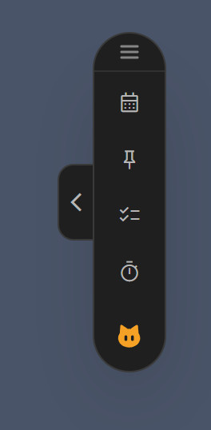
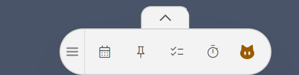
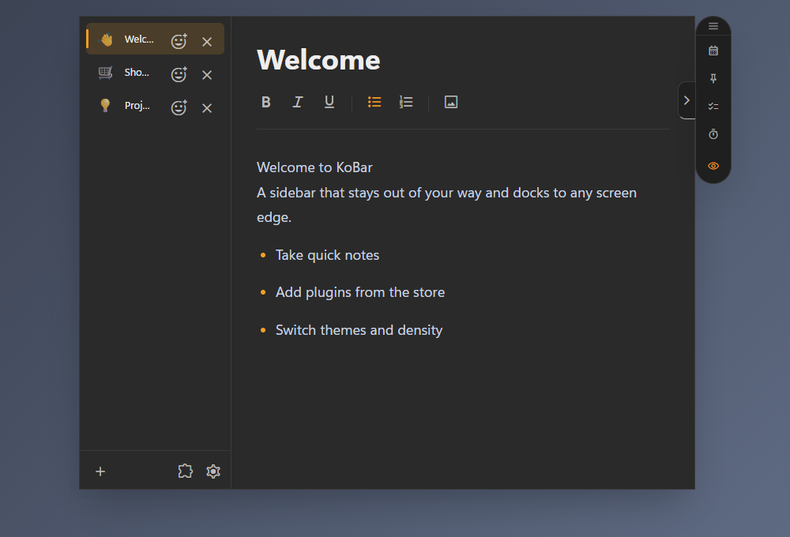
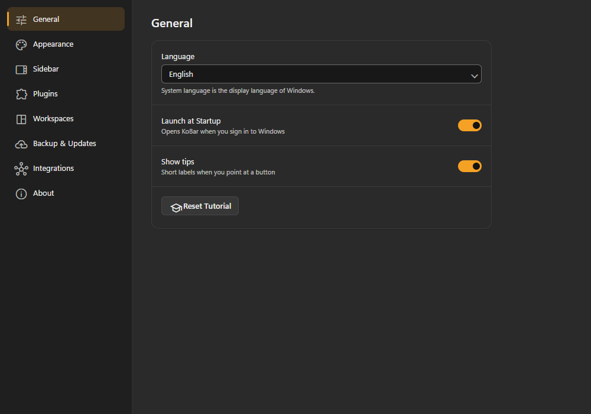
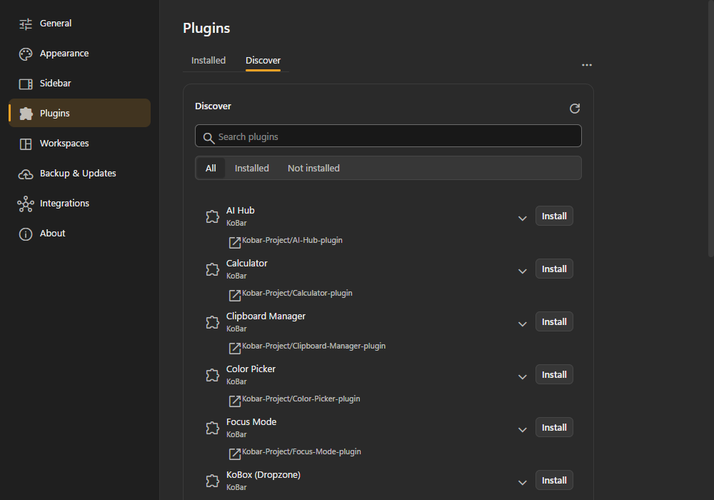

<h1 align="center">
  <picture>
    <source media="(prefers-color-scheme: dark)" srcset="Assets/images/kobar-lockup-on-dark.svg" />
    
  </picture>
</h1>

<p align="center">
  A modular, always-on-top desktop sidebar for notes and plugins.
</p>

<p align="center">
  <a href="https://github.com/Kobar-Project/KoBar/releases"></a>
  <a href="https://github.com/Kobar-Project/KoBar/releases"></a>
  <a href="https://apps.microsoft.com/store/detail/9P2KPFF3G9L9?cid=DevShareMCLPCS"></a>
  <a href="LICENSE.md"></a>
</p>

## What is KoBar

KoBar is a frameless, transparent, always-on-top bar that docks to the edge of your screen. It has a built-in notes panel, and everything else (clipboard manager, media controls, screenshots, calculator and more) is added as plugins, so you install only the tools you want. It is built with Electron and React. Website: [kobar.org](https://kobar.org/).

[Watch the trailer on YouTube](https://www.youtube.com/watch?v=KfZmoITxg2E)

## Screenshots

<table>
  <tr>
    <td align="center" valign="middle"></td>
    <td align="center" valign="middle"></td>
  </tr>
  <tr>
    <td></td>
    <td></td>
  </tr>
  <tr>
    <td colspan="2" align="center"></td>
  </tr>
</table>

## Features

- **Bar**: vertical or horizontal, always on top. Mini mode collapses it to a small floating icon. The header at the top (or left) end of the bar drags it; a click opens the bar menu.
- **Notes**: a note list with a rich-text editor.
- **Workspaces**: save a layout (theme, sizes, enabled plugins) and switch between layouts. A workspace can keep its own notes and plugin data. This is for organising your work, not a privacy boundary: installed plugins can still read other workspaces.
- **Settings window**: General, Appearance, Sidebar, Plugins, Workspaces, Backup and Updates (the update centre is not in the Store build), Integrations and About.
- **Appearance**: light, dark or follow the system; eight accent colours plus a custom colour.
- **Languages**: 10 (English, Turkish, German, French, Spanish, Russian, Japanese, Chinese, Arabic, Hindi).
- **Backup and restore**: export notes, settings, workspaces and plugin data to one file, and restore it from Settings. KoBox files are not included.
- **Plugin safety**: installing, updating and uninstalling a plugin asks for confirmation. Plugins that do not come from the official Kobar-Project organisation get an "unverified" warning.
- **KoBox** (official plugin): files dropped into KoBox are moved there, not copied; cleanup sends them to the Recycle Bin instead of deleting them permanently.

## Official plugins

Plugins are installed from the plugin store in Settings. These 13 are maintained by the KoBar project.

| Plugin                                                                       | What it does                                                    |
| ---------------------------------------------------------------------------- | --------------------------------------------------------------- |
| [AI Hub](https://github.com/Kobar-Project/AI-Hub-plugin)                     | AI assistant for several providers, including local models      |
| [Clipboard Manager](https://github.com/Kobar-Project/Clipboard-Manager-plugin) | Multi-slot sequential clipboard with image support              |
| [Snippet Vault](https://github.com/Kobar-Project/SnippetVault-plugin)        | Saved text templates, code snippets and prompts                 |
| [Screenshot Studio](https://github.com/Kobar-Project/Screenshot-plugin)      | Region and full-screen capture with an annotation editor        |
| [KoPlayer](https://github.com/Kobar-Project/KoPlayer-plugin)                 | System media controls with album art                            |
| [KoCalendar](https://github.com/Kobar-Project/KoCalendar-plugin)             | Calendar and event alerts                                       |
| [Focus Mode](https://github.com/Kobar-Project/Focus-Mode-plugin)             | Timer with ambient melodies                                     |
| [Calculator](https://github.com/Kobar-Project/Calculator-plugin)             | Floating scientific calculator with history                     |
| [Color Picker](https://github.com/Kobar-Project/Color-Picker-plugin)         | Pick a colour from the screen (HEX, RGB, HSL)                   |
| [KoBox](https://github.com/Kobar-Project/KoBox-plugin)                       | Drag-and-drop file staging area                                 |
| [PinWindowToTop](https://github.com/Kobar-Project/PinWindowToTop-plugin)     | Keep another application's window on top                        |
| [Shortcuts](https://github.com/Kobar-Project/Shortcuts-plugin)               | Application launcher and shortcut manager                       |
| [ToDo List](https://github.com/Kobar-Project/ToDoList-plugin)                | Small task list with priorities                                 |

## Experimental

**Google Calendar** (Settings > Integrations) is a read-only integration and is off by default. It currently works only in the development environment: it needs a local Google OAuth client file that is not part of the packaged app.

## Install

- Windows 10/11: [Microsoft Store](https://apps.microsoft.com/store/detail/9P2KPFF3G9L9?cid=DevShareMCLPCS), or download the installer from [GitHub Releases](https://github.com/Kobar-Project/KoBar/releases).
- macOS: experimental. Some features may be limited or unavailable. Builds, when published, are on [GitHub Releases](https://github.com/Kobar-Project/KoBar/releases).

## For developers

Requirements: Node.js `^24.21.0` (`engines` in `package.json`; `.nvmrc` pins 24.21.0, the Node bundled in Electron 44.7) and npm.

```bash
git clone https://github.com/Kobar-Project/KoBar.git
cd KoBar
npm install
npm run dev
```

| Script                                                       | Purpose                                              |
| ------------------------------------------------------------ | ---------------------------------------------------- |
| `npm run dev`                                                | Vite and Electron in development mode                |
| `npm test`                                                   | Unit tests (Vitest)                                  |
| `npm run test:e2e`                                           | End-to-end tests (Playwright)                        |
| `npm run lint`                                               | ESLint                                               |
| `npm run build`                                              | Type-check and build (no packaging)                  |
| `npm run kobar-build`                                        | Build manager for packaging                          |
| `npm run dist:store` / `dist:direct:win` / `dist:mac`        | Package the Store, direct Windows or macOS build     |

Project map:

```
electron/      Main process, preload scripts, workers
src/           Renderer: App, sidebar, notes, settings, backup, store, i18n, theme
shared/        Types and helpers shared by main and renderer
tests/         Unit and end-to-end tests
tools/         Build and packaging scripts
for-agents/    Guides for AI coding agents
build/         App icons and packaging resources
Assets/        Images, melodies and note templates
```

See [CONTRIBUTING.md](CONTRIBUTING.md) before opening a pull request and [SECURITY.md](SECURITY.md) to report a vulnerability.

## Plugin development

Plugins are plain JavaScript that run in the app's renderer. The current (v1) API is five globals:

- `window.React` and `window.ReactDOM`
- `window.useAppStore`: the app's Zustand store
- `window.api`: the preload bridge to the main process
- `window.KoBarExtensions`: registers buttons, panels and settings

The full contract is in [for-agents/kobar-plugin-developer/SKILL.md](for-agents/kobar-plugin-developer/SKILL.md).

Plugins have full access to the app window. Installed plugins are not sandboxed, so install only plugins you trust.

The `kobar` and `kobox` prefixes are reserved for KoBar and its official plugins. Backup restore treats `localStorage` keys (and plugin ids) that start with them, case-insensitively, as belonging to KoBar, so a third-party plugin cannot claim them. Prefix your keys with your own plugin id.

A new plugin API (v2) is planned for KoBar 2.0. The v1 API will be removed then.

To list a plugin in the store: add a `manifest.json` (or `kobar.json`) to the repository root, publish a GitHub Release with the plugin `.zip`, then open a pull request that adds `Username/RepositoryName` to `plugins.json` in [kobar-plugins-registry](https://github.com/Kobar-Project/kobar-plugins-registry). Listing is not a security review.

### Developing with AI agents

`for-agents/` holds guides for coding agents: the plugin API (`kobar-plugin-developer`) and the current design rules (`kobar-ui-ux-designer`). To test a plugin from source, create a git-ignored `pluginsPlayground/` folder at the repository root; an unpackaged build (`npm run dev`) loads plugins from it. See section 6 of the plugin guide.

## Sponsors

No sponsors at the moment. Would you like to sponsor KoBar? Write to [hello@kobar.org](mailto:hello@kobar.org).

## Author and contact

Made by [Ekrem EDALI](https://github.com/eedali). Contact: [hello@kobar.org](mailto:hello@kobar.org).

## License

MIT. See [LICENSE.md](LICENSE.md).
